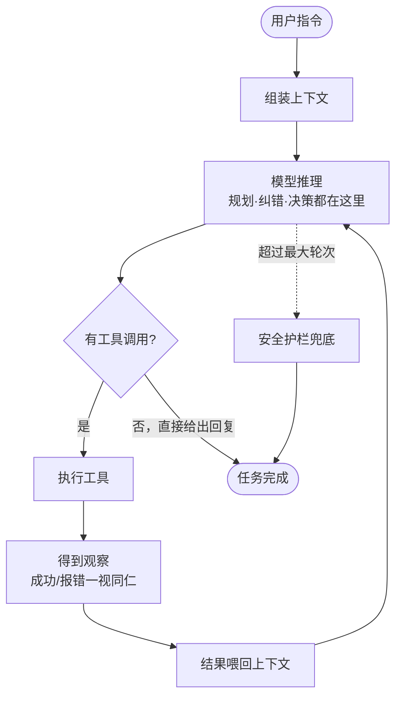

# 《Claude Code 原理解析》系列 · 第 2 篇
## Agent Loop：一个 while 循环凭什么够用

### 写在前面

上一篇我们立了一个判断标准：**复杂度应该交给更会增长的那一方（模型）。** 这一篇就来看这套哲学的心脏——Agent Loop。

如果要用一行伪代码概括 Claude Code 的运行核心，大概是这样：

```
while not done:
    response = model(context)
    if response.has_tool_calls:
        results = execute(response.tool_calls)
        context += results
    else:
        done = True
```

懂行的人第一反应往往是："就这？" 是的，就这。**这一篇要回答的，不是它怎么写，而是它凭什么不需要更多——为什么不需要状态机、不需要 planner、不需要复杂的错误处理。**

把这段伪代码画成流程图，它长这样——注意，规划、纠错、完成判断这些"聪明活"全都发生在"模型推理"这一个节点里：



---

### 一、智能涌现于循环的累积，而非编排的精巧

传统软件工程的直觉是：复杂的行为需要复杂的控制流。于是我们习惯用状态机、DAG、工作流引擎去"编排"一个 Agent 的行为——先规划、再执行、遇错回滚、完成校验……每一步都对应一个显式的节点和转移。

Claude Code 的反直觉之处在于：**它把控制流压缩成了一个最朴素的循环，然后把"行为的复杂性"完全留给了循环内部的模型推理。**

这背后是一个关键认知转变：

> 在 LLM 时代，**一次模型调用本身就是一个高度复杂的"决策黑箱"**。你不需要在外面再套一层复杂控制流去"指挥"它，你只需要不断地把世界的最新状态喂给它，让它自己决定下一步。

智能不在某一次调用里，而在**循环的累积**里。单看一步，模型只是"看了上下文、说了句话、调了个工具"；但几十步累积下来，自我纠错、试探、回溯、规划，全都涌现了出来——**而这些都不是框架写出来的，是循环跑出来的。**

这就是为什么"就这"反而是优点：循环越简单，模型能发挥的空间就越大。

---

### 二、为什么不需要独立的 Planner

AutoGPT 那一代的标志性设计，是一个显式的规划器：先让模型生成一个任务列表，再逐条执行。这看起来很合理——人不也是先列计划再做事吗？

但显式 planner 有两个致命问题：

1. **计划与现实脱节。** 规划是在"还没看到真实情况"时做出的。一旦执行中发现现实和预想不符（文件结构不一样、报错、依赖缺失），那个事先生成的静态计划就开始拖后腿。
2. **它锁死了模型的发挥空间。** planner 的拆解方式是框架定的，模型只能在你给的框架里填空。模型本可以有更聪明的拆法，但被结构挡住了。

Claude Code 的做法是：**让规划成为循环里的一种自然行为，而不是一个独立阶段。** 模型在每一轮都可以重新评估：现在该干什么？要不要换思路？是不是该先看看那个文件？规划不是一次性产出的静态产物，而是**每一轮都在隐式发生、随时可被修正的动态过程**。

换句话说：**planner 不是被删掉了，而是被溶解进了循环本身。** 计划随着观察不断流动，这恰恰是静态 planner 做不到的。

---

### 三、错误处理：把报错当成"普通的观察"

传统系统里，错误是需要专门处理的异常路径——try/catch、重试策略、回滚逻辑、降级方案。一个健壮的工作流引擎，光异常分支可能就比主逻辑还多。

Claude Code 在循环层面几乎没有"错误处理"这个概念。原因很简单：

> **在 Agent Loop 里，错误和成功的处理方式是一样的——都只是"把结果喂回给模型"。**

命令执行失败了？把 stderr 原样塞回上下文。文件不存在？把"文件不存在"这条信息喂回去。测试没通过？把失败的测试输出喂回去。然后——**循环继续转，由模型来决定怎么应对。**

这是一个深刻的简化：**框架不需要理解错误，只需要忠实地传递错误。** 理解和应对错误，是模型的工作。模型看到报错后，往往会自己调整方案、重试、换路径——这正是人类程序员面对报错时做的事。

于是那一大坨异常处理代码消失了，取而代之的是一个统一的、对称的数据流：**动作 → 观察（无论成败）→ 喂回 → 再决策。** 错误不再是需要特殊对待的"异常路径"，它只是循环的常规燃料。

---

### 四、停止条件：让模型说"我做完了"

循环必须有出口。怎么判断任务完成？

一种思路是框架来判断：定义明确的完成标准、校验输出、检查副作用。但这又回到了"框架替模型操心"的老路——而"任务是否完成"这种判断，恰恰高度依赖语义理解，正是模型擅长、框架笨拙的领域。

Claude Code 的选择是：**当模型不再请求调用任何工具、而是直接给出最终回复时，就意味着它认为任务完成了。** 停止信号由模型自己发出。

当然，工程上会有兜底——比如最大轮次限制，防止模型陷入死循环、无限烧 token。但这只是**安全护栏**，不是**主控逻辑**。主控的判断权，始终在模型手里。

这里再次体现了那条主线：**凡是模型能做好的判断，就不要在框架里硬编码。** "是否完成"是一个语义判断，于是它归模型。

---

### 五、和前辈的对比：同一个循环，不同的重心

把视角拉远，你会发现 Agent 的范式演进，其实是"重心"在循环和框架之间的转移：

- **ReAct**：第一次把"推理（Thought）→ 行动（Action）→ 观察（Observation）"显式串成循环，奠定了范式。但它更多是一个研究原型，缺工程化的工具体系和上下文管理。
- **AutoGPT / BabyAGI**：在循环外面套了厚重的规划与记忆模块，**重心在框架**。结果是框架成了天花板。
- **Claude Code**：继承了 ReAct 的循环骨架，但把规划、纠错、停止判断**全部收敛回循环内部的模型推理**，框架退到最薄。**重心彻底压在模型这一侧。**

同样是一个循环，差别全在于：**你信不信任循环里那个模型，敢不敢把决策权交给它。** Claude Code 的答案是：敢。

---

### 小结与下一篇预告

这一篇的核心就一句话：

> **Agent Loop 之所以能用一个朴素的 while 撑起整个系统，是因为它把规划、纠错、完成判断这些"聪明活"全部交给了循环里的模型，而框架只负责忠实地驱动循环、传递观察。**

但循环要转起来，模型得有"手脚"去和世界交互——这就是**工具**。下一篇我们来看 Claude Code 的工具设计哲学：**为什么是少量通用原子工具加一个 `bash` 逃生舱，而不是几十个专用工具。**
