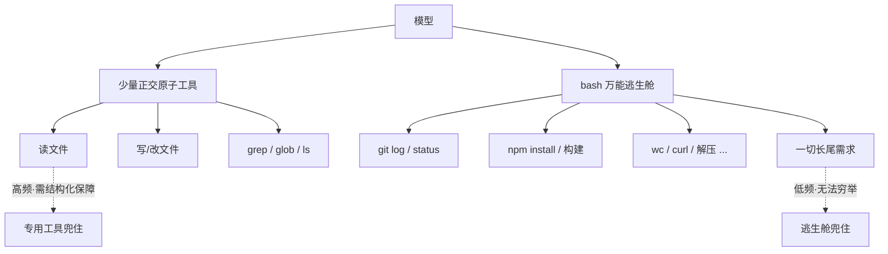

# 《Claude Code 原理解析》系列 · 第 3 篇
## 工具设计：接口的"模型人体工学"

### 写在前面

上一篇我们看到，Agent Loop 把决策权交给了模型。但模型只会"说话"——它要影响真实世界（读文件、改代码、跑命令），必须通过**工具**。

工具是模型的手脚。而 Claude Code 在工具设计上的核心洞察是：

> **工具是给模型用的 API，不是给人用的 API。它的设计目标是"模型好用"，而不是"人好用"或"接口优雅"。**

这一篇讲的就是这种"模型人体工学"（ergonomics for models）的取舍。

---

### 一、少量通用原子工具，而非一堆专用工具

直觉上，要让 Agent 能干更多事，就该给它更多工具：一个查 Git 状态的工具、一个跑测试的工具、一个安装依赖的工具、一个格式化代码的工具……工具越多，能力越强，对吧？

错。**工具越多，模型越容易选错。**

每多一个工具，就多一份"在什么情况下该用哪个"的决策负担。几十个功能重叠、边界模糊的工具，会让模型在选择上犯错、内耗，也撑大了系统提示。这是一种**组合爆炸式的认知负担**。

Claude Code 的选择是反过来的：**提供少量正交、通用的原子能力。** 大致就是几类：

- **读**：读取文件内容
- **写 / 改**：创建、覆盖、局部编辑文件
- **执行**：运行 shell 命令（`bash`）
- **搜索 / 导航**：`grep`（找内容）、`glob`（找文件）、列目录

注意这几类能力之间几乎没有重叠——它们是**正交**的。模型几乎不会纠结"该用读还是用搜索"，因为它们的职责泾渭分明。少而正交，**决策成本就低**。

能力的丰富性，不靠工具数量堆出来，而靠这些原子工具的**组合**涌现出来——这正是下一节的主题。

---

### 二、`bash` 作为"万能逃生舱"：用一个工具换无限能力

这是 Claude Code 工具设计里最聪明的一招。

你不可能为每一种操作都预先准备一个工具——查 Git 历史、统计代码行数、运行构建、curl 一个接口、解压文件……穷举是不可能的。传统思路会陷入"需求来了就加一个工具"的无限循环。

Claude Code 的解法是给模型一个 `bash`：**一个能执行任意 shell 命令的工具。**

这一个工具，等价于把整个操作系统的命令行生态都交给了模型。需要看 Git 日志？`git log`。需要统计？`wc -l`。需要装包？`npm install`。**你不需要预设这些能力，模型自己会用它早已在训练中见过千万次的命令行工具。**

这背后又是第 1 篇那条主线：**凡是模型已经会的，就不要在框架里重新封装一遍。** 模型对 shell 命令的掌握，是它预训练就具备的庞大知识；与其把这些能力一个个重新包成"工具"，不如直接开一个口子让它发挥。

`bash` 就是那个口子——一个工具，换来近乎无限的能力扩展。专用工具负责高频、需要结构化保障的操作（比如文件编辑）；`bash` 兜住所有长尾。这种"**少量专用 + 一个万能逃生舱**"的组合，是工具集设计的黄金比例。

用一张图看这个"黄金比例"：少数正交的专用原子工具守住高频刚需，`bash` 一个口子接住整个命令行生态的长尾：

---

### 三、返回结果的设计：信息量与 token 成本的平衡

工具设计里一个容易被忽视、但至关重要的维度是：**工具返回什么，以及怎么返回。**

记住：工具的返回结果会被**原样塞回上下文**，成为模型下一轮推理的输入。这意味着返回结果有两个相互拉扯的约束：

1. **信息量要够**：模型得到的信息必须足以做出正确的下一步判断。
2. **token 成本要省**：上下文窗口是有限预算（第 4 篇详谈），返回越啰嗦，预算烧得越快、噪声越多。

于是工具设计里到处是这种权衡：

- 读一个一万行的文件，是全量返回，还是分页 / 带行号截断？
- 命令输出几千行，是全吐回去，还是截断并提示"还有更多"？
- 报错信息，是给完整堆栈，还是给关键几行？

好的工具返回，是**为模型的下一步决策服务的**——给它刚好够用的信息，既不让它"瞎"，也不用噪声把它淹没。比如读文件时带上**行号**，看似是个小细节，实则极大方便了模型后续做"在第 N 行做局部编辑"这类精确操作。**这就是"模型人体工学"的具体体现：每一个返回格式的细节，都在为模型的认知减负。**

---

### 四、反模式：function-calling 大杂烩与插件化幻觉

理解了上面的取舍，就能看清几种常见的反模式：

- **function-calling 大杂烩**：给模型挂上几十上百个细粒度函数，以为"能力越全越好"。实际结果是模型在工具选择上频繁出错、系统提示臃肿、维护成本爆炸。**工具数量不是能力，正交性才是。**
- **插件化幻觉**：把每个第三方服务都包成一个专用插件/工具。短期看很"完整"，长期看是无尽的维护负担——而其中绝大多数，一个 `bash` + `curl` 就能覆盖。
- **过度结构化的返回**：把工具结果包装成复杂的嵌套 JSON，以为"结构化 = 好"。但模型读的是文本，过度结构化反而增加解析负担、浪费 token。**对模型友好的返回，往往是清晰的纯文本，而非给机器解析的 schema。**

这些反模式有一个共同根源：**用"给人/给传统程序设计 API"的直觉，去设计"给模型用的 API"。** 而这两者的人体工学，是不一样的。

---

### 小结与下一篇预告

这一篇的核心：

> **工具是给模型用的接口。好的工具集是"少量正交的原子工具 + 一个 `bash` 万能逃生舱"，返回结果则在信息量与 token 成本之间为模型的下一步决策精心权衡。**

工具的返回会进入上下文，而上下文是整个系统最稀缺的资源。下一篇我们就来谈 Claude Code 的**上下文工程**：在有限的窗口预算里，到底该让模型看见什么、又该如何取舍。
