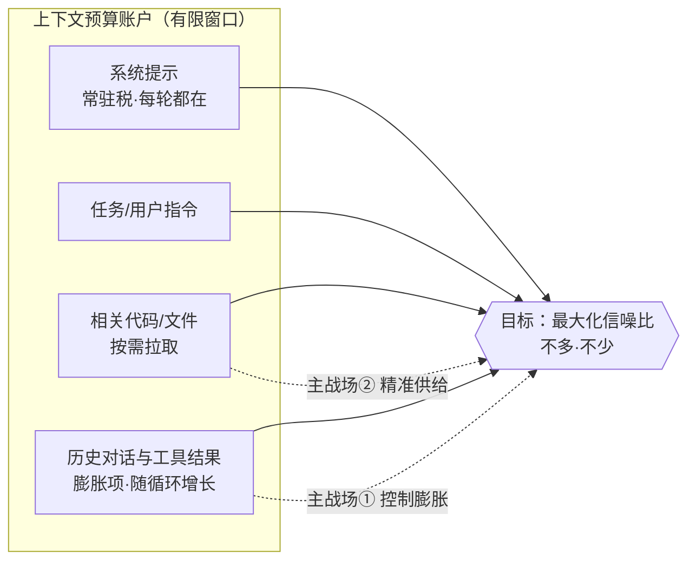
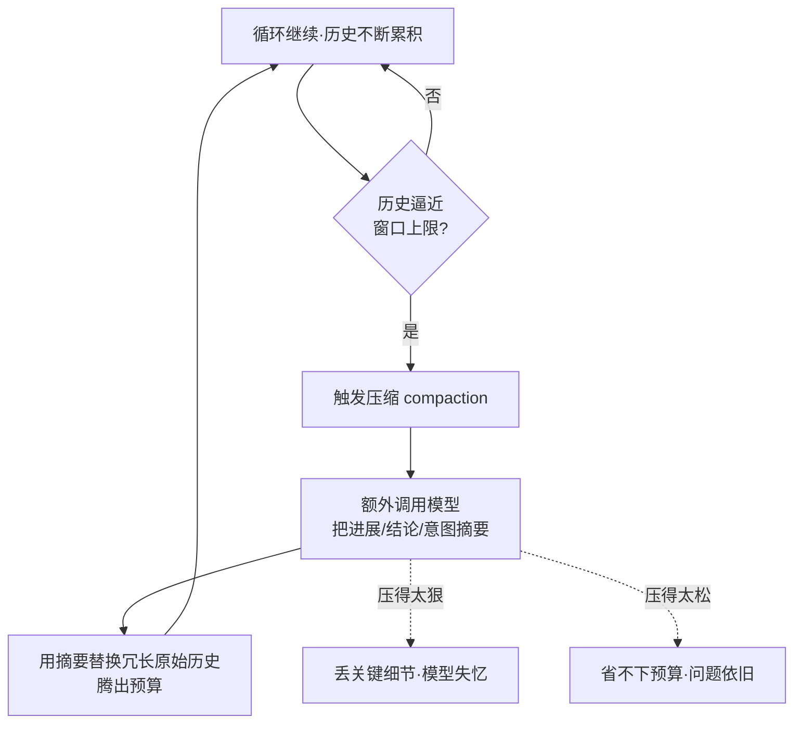

# 《Claude Code 原理解析》系列 · 第 4 篇
## 上下文工程：有限预算下的信息架构

### 写在前面

前三篇我们讲了哲学（把复杂度交给模型）、循环（系统的心脏）、工具（模型的手脚）。但有一个贯穿始终、却还没正面拆解的东西：**上下文**。

第 1 篇说过，Claude Code 把复杂度押在两个地方——模型层和**上下文层**。模型层我们左右不了（那是 Anthropic 训练出来的），但**上下文层，恰恰是工程师能施展、也最该施展的地方。**

这一篇的核心断言：

> **在模型能力既定的前提下，一个 Agent 的实际表现，常常不是被模型卡住，而是被上下文管理卡住。**

---

### 一、上下文是一个"预算账户"，不是一个"容器"

很多人把上下文窗口理解成一个容器：能装多少就装多少，装满为止。这个心智模型是错的。

正确的心智模型是：**上下文是一个有限的预算账户，每一个 token 都是开销，你要为"花在哪"负责。**

为什么是"预算"而不是"容器"？因为往上下文里塞东西，有两重成本：

1. **直接成本**：token 要花钱、要增加延迟。
2. **隐性成本（更关键）**：**无关信息是噪声。** 上下文里塞的垃圾越多，模型越容易被干扰、注意力被稀释、关键信息被淹没。这就是常说的"context rot"——窗口没满，但信噪比已经塌了，模型表现反而下降。

所以上下文工程的第一性原理不是"尽量多塞有用的"，而是：

> **在有限预算内，最大化信噪比——让模型在每一轮都恰好看到它需要的，不多，不少。**

这一句话，统领本篇剩下所有的取舍。

---

### 二、该往上下文里放什么

一轮模型调用的上下文，大致由这几部分构成，每一部分都是一道取舍题：

- **系统提示（System Prompt）**：定义模型的角色、行为准则、工具说明。它是常驻开销——每一轮都在，所以必须精炼。一个臃肿的系统提示，是在持续地、对每一轮都征税。
- **任务 / 用户指令**：用户想要什么。
- **相关代码 / 文件内容**：当前任务真正需要看的那部分代码。注意是"相关的"，不是"全部的"。
- **历史对话与工具结果**：之前几轮做了什么、看到了什么。这是随循环不断膨胀的部分，也是最需要管理的部分。

关键洞察：这四部分里，**系统提示是常驻税，历史是膨胀项**。上下文工程的主要战场，就在"如何控制历史的膨胀"和"如何精准供给相关代码"这两件事上。

下图把这个"预算账户"的构成和各自的成本性质标了出来：

---

### 三、第一道取舍：全量塞入 vs 按需检索

当模型需要了解一个代码库时，有两种极端策略：

- **全量塞入**：把相关文件（甚至整个仓库）一股脑塞进上下文。优点是信息全；缺点是预算瞬间烧光、噪声爆炸，而且大多数内容根本用不上。
- **按需检索**：先不放，等模型明确需要时，再通过工具（读文件、搜索）把特定内容取进来。

Claude Code 的取向明显偏向**按需检索**——这其实是第 2、3 篇的自然结果：模型在循环里自己决定"现在需要看哪个文件"，然后用工具去取。**上下文不是被一次性灌满的，而是被模型在循环中按需、增量地"拉取"进来的。**

这带来一个优雅的性质：**只有被实际需要的信息，才会进入上下文。** 模型的"探索路径"本身就成了一种天然的相关性过滤器——它不会去读它判断为无关的文件，于是那些文件的内容也就永远不会占用预算。这比任何预先的相关性算法都更贴合当前任务。

（至于"按需检索时，用确定性搜索还是向量检索"——这是个足够重要、足够反直觉的问题，单独留给第 5 篇。）

---

### 四、第二道取舍：历史膨胀与压缩（Compaction）

长任务有个绕不开的问题：循环跑得越久，历史越长，上下文迟早会逼近窗口上限。怎么办？

直接截断（把最早的对话丢掉）是危险的——早期的关键决策、用户的原始意图，可能就藏在被丢掉的部分里。

更成熟的做法是**压缩 / 摘要（compaction）**：当历史长到一定程度，让模型把"到目前为止发生了什么、得到了哪些关键结论、当前进展到哪"总结成一段精炼的摘要，用这段摘要替换掉冗长的原始历史，腾出预算继续往下走。

这里的取舍是**保真度 vs 预算**：

- 压得太狠，丢失关键细节，模型"失忆"，后续走偏。
- 压得太松，省不下预算，问题依旧。

而且压缩本身是有代价的——它需要额外的模型调用，且每一次摘要都有信息损耗风险。所以**何时触发压缩、压到什么程度**，本身就是上下文工程里的一门手艺。它不是一个能一劳永逸写死的规则，而是要在"让模型记住足够多"和"给未来留足够预算"之间持续权衡。

压缩的触发与取舍可以画成这样：

---

### 五、第三道取舍：系统提示里放"规则"还是放"示例"

系统提示是常驻成本，所以"它该写什么"格外讲究。一个长期争论是：**该写抽象规则，还是给具体示例？**

- **规则**（"编辑文件时要保留原有缩进"）：紧凑、覆盖面广，但模型可能理解有偏差。
- **示例**（给一段正确编辑的样例）：直观、不易误解，但占 token，且容易让模型过拟合到示例的表面形式。

实务上的平衡通常是：**用精炼的规则覆盖大多数情况，只在那些"规则说不清、模型反复犯错"的关键点上，用最少的示例去锚定。** 核心仍然是那条第一性原理——**每一个放进系统提示的字，都在为之后的每一轮征税，所以要花得值。**

---

### 小结与下一篇预告

这一篇的核心：

> **上下文是有限预算而非容器，上下文工程的目标是最大化信噪比。Claude Code 偏向"按需检索 + 适时压缩"，让模型在循环中增量地拉取它真正需要的信息，而不是一次性灌满。**

我们反复提到"按需检索"，但回避了一个关键问题：当模型要在一个大代码库里找东西，它该用什么方式找？业界的默认答案是"向量检索"，而 Claude Code 给了一个反直觉的答案——下一篇，我们专门来谈**为什么是 grep/glob，而不是向量数据库**。
