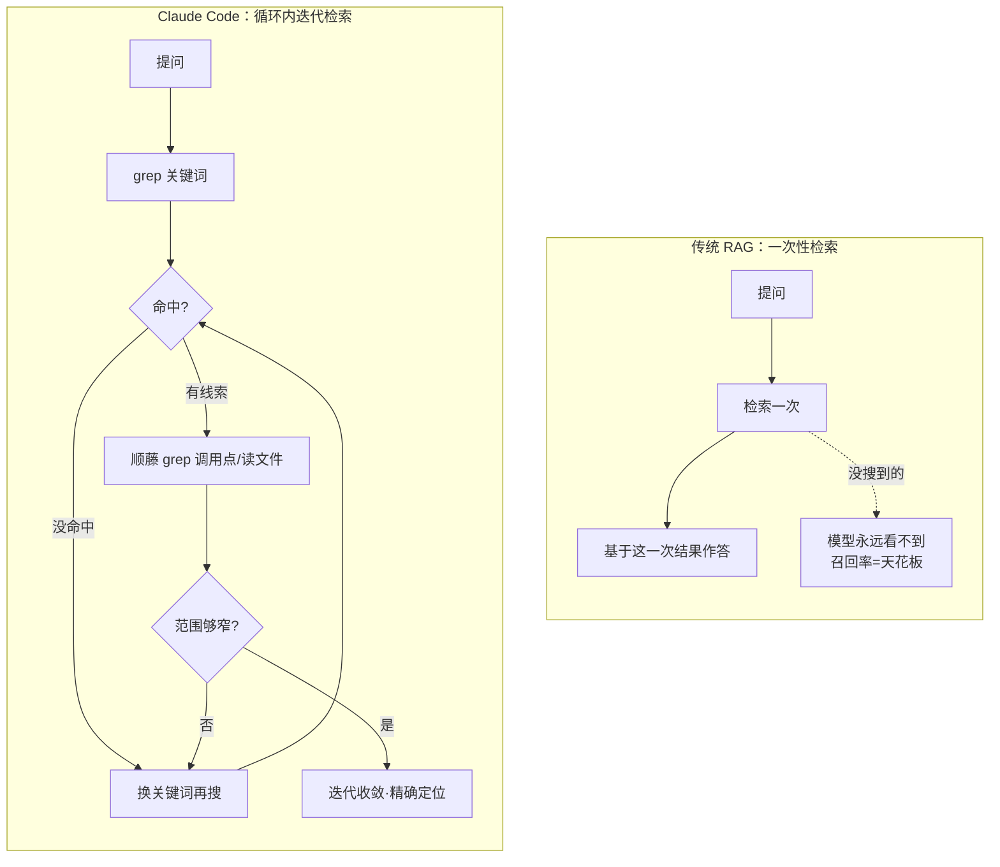

# 《Claude Code 原理解析》系列 · 第 5 篇
## 代码导航：为什么是 grep/glob，而不是向量检索

### 写在前面

这一篇是整个系列里最反直觉、也最值得懂行的人停下来想一想的一章。

过去两年，"给 AI 接代码库"几乎成了一道有标准答案的题：把代码切块（chunking）→ 算 embedding → 存进向量数据库 → 检索时做语义相似度匹配（即 RAG）。这套方案如此流行，以至于很多人把它当成了唯一正确的工程范式。

而 Claude Code 的默认选择是：**不用向量数据库，而是让模型用 `grep`、`glob`、`ls` 这类确定性工具，像人一样去翻代码。**

这一篇要回答的就是：**为什么对"代码"这种特定语料，确定性搜索反而比语义检索更优。**

---

### 一、先想清楚：代码和散文是不一样的语料

向量检索（RAG）最初是为什么场景设计的？是为**非结构化的自然语言**——一堆文档、网页、客服记录。在那种场景里，你问"怎么退货"，文档里写的是"申请退换货流程"，字面不匹配，但语义相同。**这正是 embedding 的主场：跨越字面差异，捕捉语义相似。**

但代码不是散文。代码有一组散文不具备的性质：

- **强结构**：有明确的目录树、文件、函数、类、import 关系。
- **精确命名**：一个函数叫 `getUserById`，你想找它，就是要找这个确切的符号，而不是"语义相近"的东西。
- **可被确定性匹配**：函数名、变量名、字符串、调用点，都能用正则精确、无歧义地命中。

一旦意识到"代码是强结构、可精确匹配的语料"，就会发现：**把它降维成一堆 embedding 向量去做模糊相似度匹配，其实是丢掉了它最宝贵的性质——精确性。**

---

### 二、确定性搜索 vs 向量检索：四个维度的硬碰硬

让我们把两种方案放在一起，逐个维度对比。

**1. 精确性**
- `grep "getUserById"`：精确命中所有出现该符号的位置，零漏报、零误报。
- 向量检索：返回的是"语义相近"的若干块，可能漏掉真正的定义，也可能混进一堆不相关但"看起来像"的代码。
- → **对需要精确定位的代码操作，确定性搜索完胜。**

**2. 新鲜度**
- `grep`：直接跑在当前磁盘上的代码上，**永远是最新的**。你改一行，下一秒搜出来的就是新的。
- 向量库：需要预先建索引。代码一改，索引就过期，必须重建。在一个文件每分钟都在变的编码场景里，**索引的维护和失效是个持续的噩梦**。
- → **编码是高频变更场景，确定性搜索的"零索引、永远新鲜"是巨大优势。**

**3. 成本与复杂度**
- `grep`/`glob`：零额外基础设施。不需要 embedding 模型、不需要向量数据库、不需要建索引的流水线。开箱即用。
- 向量检索：要选 embedding 模型、要部署向量库、要设计 chunking 策略、要维护索引更新——一整套需要运维的子系统。
- → 回到第 1 篇的主线：**向量方案是把复杂度押在了框架层。而框架层的复杂度，是要持续偿还的。**

**4. 可解释性**
- `grep`：模型（和你）清楚地知道"我搜了这个词，命中了这些行"。行为完全透明、可复现。
- 向量检索："为什么返回了这几块、漏了那一块"是一个黑箱，难以调试。
- → **透明可复现 vs 黑箱，对构建可信赖的 Agent 至关重要。**

---

### 三、关键转折：Agent 能搜索，所以不需要"一次检索对"

这里有一个最容易被忽略、却最致命的点。

传统 RAG 的范式是**一次性的**：检索一次，把结果塞进上下文，然后让模型基于这一次检索的结果作答。在这种"一锤子买卖"里，检索的召回率就是天花板——**第一次没检索到的，模型就永远看不到。** 所以大家拼命优化 embedding、优化 chunking，就为了提高那一次的命中率。

但 Claude Code 不是一次性检索，它是在**循环**里（第 2 篇）。这彻底改变了游戏规则：

> **模型可以搜了再搜。** 第一次 `grep` 没找到？换个关键词再搜。找到一个线索？顺着它 `grep` 调用点、读相关文件、再缩小范围。

这正是**人类程序员探索陌生代码库的方式**：搜一个词 → 看结果 → 调整 → 再搜 → 顺藤摸瓜。每一步都基于上一步的发现来调整下一步。这是一个**迭代收敛**的过程，而不是一次性的命中。

一旦检索变成循环里可以反复进行的动作，"单次召回率"就不再是天花板了。**简单工具 + 多轮迭代，胜过复杂工具 + 单次命中。** 这也是为什么 Claude Code 敢用"原始"的 `grep`——因为它从不指望一次搜对，它指望的是搜很多次、逐步逼近。

两种范式的差别，一图看清——左边是"一锤子买卖"，右边是"顺藤摸瓜"：

---

### 四、那么向量检索一无是处吗？——边界要划清

为了不矫枉过正，必须把适用边界说清楚。**这一篇不是在说"向量检索是错的"，而是说"它被用错了地方"。**

向量检索依然在它的主场无可替代：

- **大规模非结构化文本**：海量文档、知识库、网页、工单——字面不匹配但语义相关是常态，正则无能为力。
- **真正的语义模糊查询**："帮我找处理支付失败重试的相关逻辑"这类没有明确关键词、跨越多种表述的需求，语义检索能提供有价值的初筛。
- **超大规模代码库的粗筛**：在百万文件级别、`grep` 全量扫描成本过高时，向量检索可以作为缩小范围的"第一道粗筛"，再交给确定性工具精确定位。

所以更准确的结论是：

> **对"中小规模、强结构、需精确匹配"的代码库，确定性搜索是更优的默认选择；向量检索的价值在大规模非结构化语料和语义模糊查询。** 二者不是替代关系，而是各有主场——错配主场，才是真正的工程错误。

---

### 小结与下一篇预告

这一篇的核心：

> **代码是强结构、可精确匹配的语料，把它降维成向量做模糊匹配是丢掉了它的精确性。再加上 Agent 能在循环里"搜了再搜"，单次召回率不再是天花板——于是简单、新鲜、透明、零运维的 `grep`/`glob`，对代码导航反而是更优解。**

这又一次印证了全系列的主线：**不要在框架层堆复杂度（向量库），要相信模型在循环里的迭代能力。**

下一篇，我们把视角从"单个循环"抬高到"循环的组合"——当任务复杂到一个上下文装不下时，Claude Code 如何用**子 Agent**来分解，以及它为什么没有走向 CrewAI / AutoGen 那种重型多 Agent 编排。
