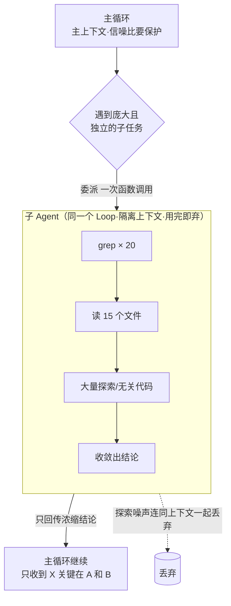

# 《Claude Code 原理解析》系列 · 第 6 篇
## 子 Agent 与任务分解：扁平 vs 多 Agent 编排

### 写在前面

前五篇我们的视角都停留在**一个**循环里。但真实任务往往很大：重构一个模块、排查一个跨多文件的 bug、调研一个不熟悉的代码库。这类任务有两个共同的麻烦：

1. **步骤太多**，几十上百轮下来，上下文迟早膨胀到失控（第 4 篇的问题）。
2. **关注点太杂**，主线任务被大量探索性的细节（读这个、搜那个）淹没，信噪比下降。

业界对此有一个很流行的答案：**多 Agent 系统**——搞一个 Manager、一个 Coder、一个 Reviewer、一个 Tester，各司其职、互相通信，像一个软件团队。CrewAI、AutoGen 是这条路线的代表。

Claude Code 的答案不一样，而且同样克制。这一篇就讲这个取舍。

---

### 一、Claude Code 的做法：递归的"同一个循环"

Claude Code 处理复杂任务的核心机制，是**子 Agent（sub-agent）**，但它的本质朴素得出人意料：

> **子 Agent 不是一个"不同角色"的新东西，它就是同一个 Agent Loop，被递归地调用了一次——只不过运行在一个全新的、隔离的上下文里。**

具体来说：主循环在执行中，遇到一个"庞大但相对独立"的子任务（比如"在整个代码库里调研清楚 X 是怎么实现的"），它可以把这个子任务**委派**出去。这个委派出去的子任务，本身又是一个完整的 Agent Loop：有自己的上下文、自己的循环、自己的工具调用。子 Agent 跑完后，**只把最终的结论返回给主循环**，而把过程中产生的几十轮探索细节，全部留在自己那个用完即弃的上下文里。

注意这里没有引入任何新范式。还是第 2 篇那个循环，只是**自己调用了自己**。复杂度没有增加新的种类，只是同一种结构的递归。

---

### 二、为什么要"隔离上下文"——这是子 Agent 的真正价值

子 Agent 最核心的价值，不在于"分工",而在于**上下文隔离**。这一点直接呼应第 4 篇。

设想没有子 Agent 的情况：主循环要调研一个问题，它在主上下文里 `grep` 了 20 次、读了 15 个文件，看了一堆最终被证明无关的代码。这些探索过程**全部堆积在主上下文里**，疯狂消耗预算，还把真正重要的主线信息淹没在噪声里。

有了子 Agent，情况就变成：

> **"脏活"在子上下文里干完，主上下文只接收干净的结论。**

调研那 20 次搜索、15 个文件的内容，全留在子 Agent 那个隔离的、用完即弃的上下文里。主循环拿到的，只是一句精炼的"X 是这样实现的，关键在 A 和 B"。**主上下文的信噪比因此被保护得很好。**

这是一种非常优雅的**上下文垃圾回收机制**：把一次性的、探索性的、高消耗的工作隔离在临时上下文里执行，结束后连同它产生的所有噪声一起丢弃，只留下结论。子 Agent 的本质，与其说是"分工",不如说是"**为了保护主上下文而做的关注点隔离**"。

下图展示这次"委派"：脏活（20 次搜索、15 个文件）全留在隔离的子上下文里用完即弃，主上下文只收到一句干净结论：

---

### 三、和多 Agent 框架的根本分野

现在把 Claude Code 的"递归子 Agent"和 CrewAI / AutoGen 式的"多角色编排"放在一起对比，差异就清晰了。

**多 Agent 编排（CrewAI / AutoGen 式）：**
- 预先定义一组**异构**的角色（Manager、Coder、Reviewer……），每个有不同的提示词和职责。
- 角色之间通过**消息传递 / 共享黑板**通信，形成一个协作网络。
- 复杂度在于：**编排本身**——谁先说话、消息怎么路由、状态怎么同步、如何避免角色间无限对话或互相甩锅。

**Claude Code 的递归子 Agent：**
- 没有预定义的异构角色。子 Agent 和主 Agent 是**同质**的（同一个循环），区别只在于被分配的任务和隔离的上下文。
- 通信极其简单：**主调用子，子返回结论**。就是一次函数调用的形态——入参是任务，返回是结果。没有复杂的消息总线。
- 复杂度被压到最低：**没有"编排"这个独立问题，只有"委派"这一个动作。**

这个分野依然是全系列那条主线的延续：

> **多 Agent 框架把复杂度押在"编排"这个框架层；Claude Code 则把它简化成"递归 + 上下文隔离",把聪明继续留给模型。**

异构多角色编排不是不能用，但它引入的协调复杂度（角色对齐、消息治理、死锁与发散）往往**得不偿失**——尤其当底层是同一个强模型时，强行给它分裂出"多个人格"再让它们开会，常常是徒增内耗。一个聪明的模型，递归地调用自己，往往比一群被人为分工的"角色"互相喊话更高效。

---

### 四、什么时候该委派，什么时候该自己干

子 Agent 不是免费的——它有额外的模型调用开销和一次上下文的冷启动。所以"何时委派"本身是个判断题。一个实用的启发式是：

- **该委派**：子任务**庞大、相对独立、且只需要返回一个浓缩结论**。典型如"调研某个机制如何实现"——过程会产生大量探索噪声，但主循环只需要最终答案。隔离它，收益最大。
- **不该委派**：子任务很小，或者它的**中间过程本身**就是主循环需要持续掌握的。强行委派只会增加开销和一层信息损耗。

而做这个判断的，又是谁呢？——还是**模型自己**，在循环里。框架只提供"委派"这个能力，至于"这一步要不要委派出去",交给模型权衡。又一次，**框架提供机制，模型行使判断。**

---

### 小结与下一篇预告

这一篇的核心：

> **Claude Code 用"递归调用同一个循环 + 隔离上下文"来分解复杂任务，而非引入异构多角色编排。子 Agent 的真正价值是上下文隔离——脏活在临时上下文里干完，主上下文只收干净结论。这比重型多 Agent 框架更简单、也更契合"强模型"的现实。**

到这里，我们已经讲完了 Claude Code 如何高效、聪明地完成任务。但有一个我们一直回避的前提：**这个能读你文件、能执行任意命令的 Agent，凭什么值得信任？** 下一篇，我们谈安全、权限与人在环——自主性的边界。
