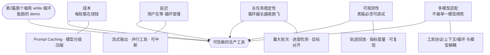

# 《Claude Code 原理解析》系列 · 第 8 篇
## 工程化的真实战场：从能跑的 demo 到可信赖的工具

### 写在前面

前七篇拆完了 Claude Code 的架构思维：哲学、循环、工具、上下文、检索、子 Agent、安全。如果你顺着读下来，可能会产生一个危险的错觉——**"原来这么简单，我一个周末也能写一个。"**

确实，一个能跑通的 mini 版本，几百行就够了（这也是本系列设计哲学的魅力：核心思想极简）。但**"能跑的 demo"和"每天有几百万开发者敢把它接进真实工作流"之间，隔着一整个工程的深渊。**

这最后一篇，专门谈那些不性感、却真正决定成败的工程问题。它们大多不属于"智能",但恰恰是它们,把一个聪明的原型变成一个可信赖的产品。

把这条深渊上的五道工程战场画成一张全景图——它们环绕着那个极简循环，每一道都对应一组具体手段：

---

### 一、成本：每一轮循环都在烧钱

第 2 篇那个优雅的 while 循环，从财务视角看是另一幅画面：**每转一轮，就是一次完整的大模型调用;一个复杂任务几十轮下来,token 账单相当可观。** 而且第 4 篇说过,上下文是累积的——越往后,每一轮要带的历史越长,单轮越贵。

于是成本工程成了一门必修课：

- **Prompt Caching（提示缓存）**：系统提示、早期上下文这些"每轮都重复"的部分，可以被缓存复用，避免重复计费。这是降本的关键杠杆——一个不用缓存的实现，成本可能是用了缓存的数倍。
- **模型分级**：不是每一步都需要最强（最贵）的模型。简单的子任务、格式化、分类，可以路由给更小更便宜的模型，把贵模型留给真正需要深度推理的步骤。
- **上下文压缩的经济性**：第 4 篇的 compaction，不只是为了不超窗口，也是直接的省钱手段。

**架构上"优雅的循环",在工程上必须配一套"精打细算的成本控制",否则没人用得起。**

---

### 二、延迟：用户在等，而循环很慢

Demo 里你不在乎跑 30 秒。但真实用户盯着屏幕时，30 秒的沉默是灾难。延迟是 Agent 体验的头号杀手，因为**循环天然是串行且缓慢的**——每一轮都要等模型吐完、等工具跑完，才能进下一轮。

工程上的缓解手段：

- **流式输出（Streaming）**：别等模型说完再显示，一个字一个字地流出来。**它没有让循环变快,但让等待变得可感知、可忍受**——用户看到它在动，焦虑就小了一半。
- **并行工具调用**：如果一轮里模型要读三个互不依赖的文件，没必要一个个来——并行执行，三次的延迟压成一次。
- **乐观展示与可中断**：尽早把"我打算干什么"展示出来，让用户能提前判断、必要时打断，而不是干等到最后才发现跑歪了。

延迟工程的本质，是在"循环固有的慢"这个约束下，**尽一切可能优化用户的感知体验。**

---

### 三、长任务的稳定性：循环越长，越容易跑飞

短任务很可靠，但真实任务可能要跑几十上百轮。轮次一多，各种"小概率失败"就被放大成"必然发生":

- **跑偏 / 绕圈**：模型陷入"改了又改、反复横跳"的循环，或者在两个错误方案间来回。
- **上下文漂移**：随着压缩和累积，早期的关键意图被稀释，模型逐渐"忘了"最初要干什么。
- **错误累积**：一个早期的小误判，被后续步骤当成事实不断放大。

应对这些，需要一系列"工程护栏"：最大轮次限制（第 2 篇提过的兜底）、进度检测（发现原地打转就干预）、阶段性回到初始目标做对齐、以及让用户能随时介入纠偏（第 7 篇的人在环在这里也是稳定性工具）。**这些护栏不增加智能，但它们防止智能跑飞。**

---

### 四、可观测性：黑箱必须变得可调试

传统软件出 bug，你有日志、有堆栈、有断点。但一个 Agent"行为不对"时——它为什么选了那个工具？为什么走了那条弯路？为什么突然放弃？——如果没有可观测性，你只能干瞪眼。

所以生产级 Agent 必须把自己变得**可观测**：

- **完整的轨迹记录（trace）**：每一轮的输入上下文、模型输出、工具调用、返回结果，全部可回放。这是调试 Agent 的命根子。
- **指标度量**：成功率、平均轮次、token 消耗、各类工具的使用与失败率——没有度量，就无法优化。
- **可复现**：能把一次"翻车"的会话原样重放出来，才谈得上定位和修复。

**一个不可观测的 Agent，是无法被持续改进的**——你连它为什么错都不知道，又谈何修复。可观测性是把"碰运气调提示词"变成"工程化迭代"的前提。

---

### 五、多模型适配与演进：不被单一模型绑死

最后一个长期工程问题：模型在变。新版本发布、能力边界变化、不同模型各有所长。一个被深度绑死在某个特定模型怪癖上的系统，会在模型升级时集体崩溃。

所以成熟的架构会保持对模型的**一定抽象**：工具协议、上下文组织、循环逻辑尽量与具体模型解耦，使得换模型、升级模型、甚至混用多模型时，不需要推倒重来。

这其实呼应了第 1 篇的主线——**把复杂度押在模型层的红利,前提是你能持续"换上更强的模型"。** 如果架构和某个模型版本焊死了，你就享受不到未来模型变强带来的免费提升。**保持对模型的解耦,是为了让"蹭模型增长红利"这件事能持续兑现。**

---

### 全系列总结

走到这里，我们可以把八篇收成一张图。Claude Code 的架构思维，是一条贯穿始终的主线和它在各层的展开：

> **主线：把复杂度交给更会增长的一方——模型与上下文，让框架保持最薄。**

- **第 1 篇** 立哲学：少即是多，复杂度的归属决定架构的命运。
- **第 2 篇** 心脏：一个 while 循环，把规划、纠错、停止判断都交给模型。
- **第 3 篇** 手脚：少量正交工具 + `bash` 逃生舱，能力靠组合而非堆砌。
- **第 4 篇** 燃料：上下文是预算而非容器，目标是最大化信噪比。
- **第 5 篇** 导航：对代码用确定性的 `grep`，因为循环让"搜了再搜"成为可能。
- **第 6 篇** 分解：递归同一个循环 + 上下文隔离，而非重型多 Agent 编排。
- **第 7 篇** 边界：自主性必须配安全约束，务实地"兜住犯错"。
- **第 8 篇** 战场：成本、延迟、稳定性、可观测性——把聪明的原型变成可信赖的产品。

如果只带走一句话，那就是第 1 篇那句：

> **Claude Code 的每一个"简单",背后都是一次"把复杂度交给更会增长的那一方"的主动选择。**

理解了这一点，你就不只是理解了 Claude Code，而是握住了这一代 Agent 架构演进的方向感——**而这，正是写这个系列的初衷。**

---

### 接下来可以深挖什么

- 亲手写一个 mini 版（几百行就能跑通核心循环），用实现验证理解。
- 读 Anthropic 关于 building effective agents、context engineering 的公开文章，对照本系列的思路。
- 在你自己的领域里问一遍那个核心问题：**哪些复杂度，我正错误地押在了框架层、本该交给模型？**
