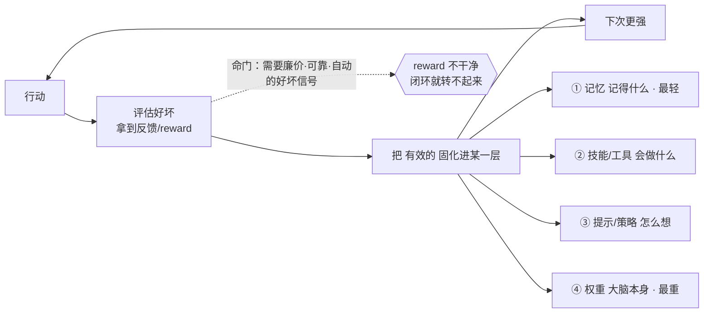
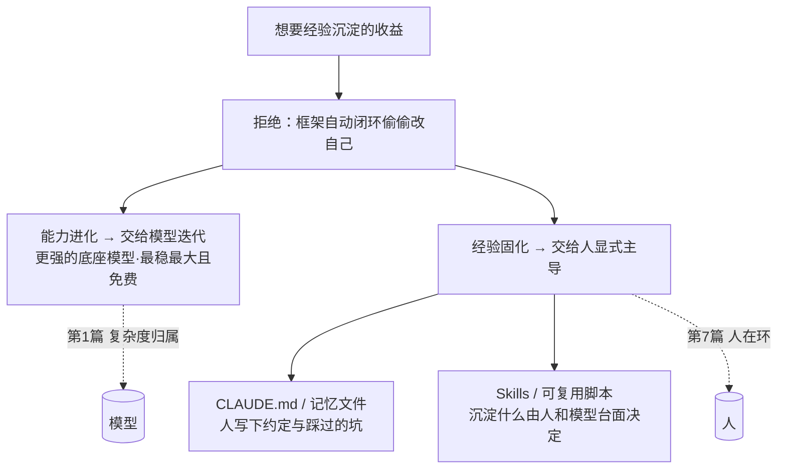

# 《Claude Code 原理解析》系列 · 番外篇（第 9 篇）
## 自进化：Claude Code 主动没走的那条路

### 写在前面

读到这里，你已经抓住了一个关键直觉：**Agent Loop 本质是一种"自己纠正自己"的机制**——动作、观察、再决策，错了就把报错喂回去重来。

于是一个很自然的追问冒出来了：既然它能在一个任务里自我纠错，那它能不能**跨任务地自我改进**？今天踩过的坑，明天就别再踩；这个项目学会的技巧，下个项目直接复用；用得越久，自己变得越强——这就是这两年很火的一个概念：**自进化（Self-Evolving / Self-Improving Agent）。**

这一篇是番外，专门把"自进化"讲清楚：它一般怎么做、适合什么场景，以及——**为什么 Claude Code 几乎刻意地没有采用它。** 你会发现，这个"不采用"的决定，恰恰是前八篇那条主线最锋利的一次应用。

---

### 一、先划清边界：自进化 ≠ Agent Loop 的自我纠错

很多人会把这两件事混为一谈，但它们处在完全不同的时间尺度上，这是理解全篇的前提：

> - **Loop 里的自我纠错**：发生在**单个任务内部**。任务结束、上下文一清空，这些纠错的"经验"也随之蒸发。它是 **episodic（一次性的）**。
> - **自进化**：发生在**跨任务、跨时间**的尺度上。它要把改进**固化下来**，沉淀成某种持久的东西，去影响未来所有任务。它是 **persistent（持久的）**。

一句话区分：**Loop 改的是"这一次的解法"，自进化改的是"Agent 自己这个本体"。** 前者用完即弃，后者把变化刻进系统里。

理解了这条边界，下面我们看自进化具体想"刻"什么。

---

### 二、AI 应用里，自进化一般怎么做

"自进化"不是单一技术，而是一类思路的统称。按"被进化的对象是什么"，大致可以分成由轻到重的几层：

**1. 进化记忆（Memory）——最轻**
把成功的解法、失败的教训写进一个长期记忆库，下次遇到相似问题先检索、再复用。代表思路是 Reflexion（把反思结果存下来指导后续）和各类"经验回放"。**改的是"记得什么"。**

**2. 进化技能 / 工具（Skills）**
让 Agent 把反复用到的操作沉淀成可复用的"技能"，甚至**自己写新工具**给自己用，技能库越滚越大。最经典的案例是 Voyager——一个在 Minecraft 里不断自建技能库、能力随时间持续增长的 Agent。**改的是"会做什么"。**

**3. 进化策略 / 提示词（Prompt / Policy）**
基于反馈，自动改写自己的提示词或决策策略。代表是 DSPy、APE、Promptbreeder 这类**自动提示词优化**——让系统自己搜索出更好的 prompt，而不是人手调。**改的是"怎么想"。**

**4. 进化权重（Weights）——最重**
用 Agent 自己跑出来的轨迹，反过来去微调 / 强化训练模型本身，形成"自己产数据、自己训自己"的闭环。代表是 STaR、自训练（self-training）、RLAIF 等。**改的是"大脑本身"。**

把这四层串起来看，自进化的核心机制其实是同一个闭环：

> **行动 → 评估好坏（拿到反馈/reward）→ 把"什么有效"固化进某一层（记忆/技能/提示/权重）→ 下次更强。**

注意这个闭环的命门是中间那一步：**它必须拿到一个相对可靠、且最好是廉价自动的"好坏信号"。** 这一点，后面会成为 Claude Code 不走这条路的关键原因。

自进化的通用闭环长这样——由轻到重，被"刻"进不同的层，但都卡在同一个命门（可靠 reward）上：

---

### 三、自进化适合什么场景

自进化不是越用越香的银弹，它有相当苛刻的适用前提。它真正发光，通常需要同时满足几个条件：

- **任务分布稳定且高度重复。** 环境和任务类型长期不变，过去学到的东西明天大概率还管用——进化才不会"学了就过期"。
- **有廉价、可靠、自动的反馈信号。** 比如游戏里的得分、仿真里的成败、有标准答案的题目。reward 越干净、越自动，闭环转得越快。
- **开放式、长周期的探索环境。** 游戏 AI、机器人、科学发现这类场景，没有"标准解法"，只能靠不断积累技能往前拱——Voyager 式的技能滚雪球在这里收益最大。
- **能容忍一定的不确定性和波动。** 进化过程必然伴随试错和退步，场景得允许它"偶尔变笨一下"。

一句话概括它的甜区：**稳定、可量化、长期、且容错的环境。** 典型如游戏智能体、仿真训练、推荐系统的长期优化、特定垂直领域的研究型 Agent。

---

### 四、Claude Code 为什么主动没走这条路

现在回到核心问题。Claude Code 作为一个生产级编码工具，几乎完美地**踩中了自进化的每一个"不适用"条件**。逐条对照：

**1. 主线决定了方向：进化红利，押在模型而非应用。**
这是最根本的一条，呼应第 1 篇。自进化的本质，是**让应用自己想办法变强**；而 Claude Code 的核心下注是**"下一个模型版本会更强"**。问题在于——**底座模型的进化速度，远远碾压应用层自我进化能挤出的那一点提升。** 与其费力搭一套脆弱的自进化闭环去抠几个百分点，不如保持框架最薄、随时换上更强的模型，免费白嫖整条曲线的红利。**自进化是把赌注押回了正在贬值的应用层，这与全系列主线背道而驰。**

**2. 编码场景缺那个最关键的"廉价可靠 reward"。**
上一节说过，自进化闭环的命门是干净的反馈信号。但代码的"好坏"恰恰极难自动量化：**测试全过 ≠ 代码就好**（可能可读性差、引入技术债、漏掉边界）。没有可靠的全局 reward，自进化的闭环根本转不起来，硬转只会把系统带偏。

**3. 任务分布太开放、太异构，"进化"难以迁移。**
每个 codebase、每个团队的规范、风格、技术栈都不同。在 A 项目"进化"出来的偏好，搬到 B 项目可能不仅没用，甚至有害。自进化要的是"稳定可复用"，而编码现场恰恰是"千人千面、千项目千面"。

**4. 它和"可信赖"直接冲突——这是产品红线。**
第 8 篇反复强调：生产工具的命根子是**可预测、可复现、可审计**。而一个会偷偷改自己提示词、改自己行为的系统，意味着**它今天和明天的行为不一致**。对一个每天接进真实代码库的工具来说，"昨天好好的，今天自己进化坏了，还查不出为什么"是灾难级的事故。**自主进化的代价，是放弃确定性——这个价码工具类产品付不起。**

**5. 错误会被固化、放大，而 Loop 的纠错用完即弃。**
这正好接上第一节那条边界。Loop 的纠错是任务内的、一次性的，错了顶多这一次任务翻车，下一次干净重来。但自进化把"改自己"**持久化**了——一旦学坏，错误会被刻进记忆/技能/权重里，持续污染未来所有任务。**持久化既是自进化的力量，也是它最危险的地方。**

---

### 五、那 Claude Code 怎么办：把"进化"交还给人和模型

有意思的是，Claude Code 并没有完全放弃"经验沉淀"带来的好处，它只是**换了一种更克制、更可控的方式**去拿——用一批"轻量替代物"实现了自进化想要的收益，却避开了它的代价：

- **`CLAUDE.md` / 记忆文件**：项目的约定、偏好、踩过的坑，**由人显式写下来**，而不是系统偷偷自学。它是"人主导的记忆固化"。
- **Skills / 可复用脚本**：常用能力可以沉淀成技能，但**是否沉淀、沉淀什么，由人和模型在台面上决定**，而非框架自动闭环。
- **更强的底座模型**：真正的"权重进化"，交给 Anthropic 的下一次模型迭代——这是最稳、最大、且免费的那条进化曲线。

看出门道了吗？这三招的共同点是：**把"要不要进化、往哪进化"的决定权，交还给人（第 7 篇的人在环）和模型（第 1 篇的复杂度归属），而不是让框架自己闭环偷偷改自己。**

> **Claude Code 不是不要进化，而是拒绝"框架层的自动自进化"。它把进化拆成两半：能力的进化交给模型迭代，经验的固化交给人显式主导——两边都不留给那层应该最薄的框架。**

一张图看清 Claude Code 如何"绕开框架自进化"，把进化红利和决策权分别交还给模型和人：

---

### 小结

回到你最初的那个直觉——"loop 是一种自己纠正自己的机制"——现在可以补全它了：

> **Loop 是"任务内"的自我纠错，廉价、安全、用完即弃；自进化是"跨任务"的自我改进，强大，但需要稳定环境、可靠 reward，并以牺牲确定性为代价。**

Claude Code 选了前者、避开了后者，不是因为做不到，而是因为**它身处一个"开放、难量化、要求绝对可信赖"的场景，又恰好赶上一个"底座模型本身在飞速进化"的时代。** 在这两个前提下，最聪明的进化策略，反而是**自己别瞎进化，把进化红利让给模型，把进化决策权让给人。**

这又一次印证了贯穿全系列的那句话：

> **Claude Code 的每一个"克制"，背后都是一次"把复杂度交给更会增长的那一方"的主动选择。** 这一次被它婉拒的，是"让框架自己变聪明"的诱惑。
