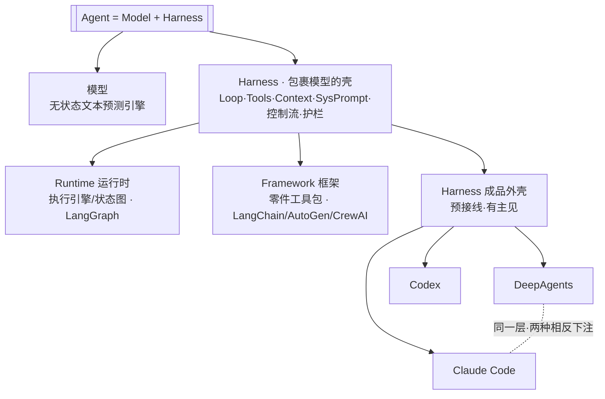
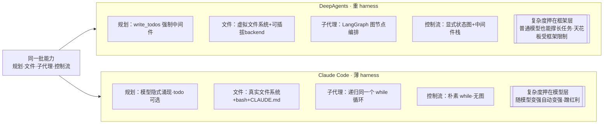

# 《Claude Code 原理解析》系列 · 番外篇（第 10 篇）
## Harness、DeepAgents、Loop Agent：三个名字，其实在讲两件事

### 写在前面

你已经吃透了 Claude Code 那个极简循环，也对 LangChain 的 **DeepAgents** 有概念。于是冒出一个很自然的对比需求：**harness、DeepAgents、Claude Code 的 loop agent，这三者到底什么关系、架构上差在哪？**

这一篇先给你一个会改变你看法的结论：

> **这三个词不在同一层级，所以不能平着比。** `harness` 是一个**抽象层次**（包裹模型的那层壳），而 DeepAgents 和 Claude Code 是这一层里的**两种具体风格**。真正的对比，是"同一个壳，两种相反的下注"——而这又一次落回全系列那条主线：**复杂度押在哪。**

把这层关系理顺，三者的区别就一目了然了。

---

### 一、先正名：Agent = 模型 + Harness

2026 年，业界把一句话焊成了共识：

> **Agent = Model + Harness。**

模型只是个无状态的文本预测引擎；真正把它变成"能干活的 agent"的，是包在外面的那层代码——**这层代码就叫 harness（驾驭外壳 / 脚手架）。** 它至少包含六样东西：

- **循环（Loop）**：反复调用模型，而不是只调一次
- **工具（Tools）**：让模型能"动手"
- **上下文（Context）**：决定模型每一轮能看到什么
- **系统提示（System Prompt）**：模型的身份与规则
- **控制流（Control Flow）**：何时停、何时叫人、何时并行
- **护栏（Safeguards）**：防死循环、防烧钱、防畸形调用

关键认知：**同一个模型 + 同一批工具，只要换一个系统提示和控制流，就是一个完全不同的 agent。** 2023 年大家比的是"用哪个模型"，2026 年比的是"怎么包这个模型"——壳，才是差异的来源。

而 harness 这个层次内部，又分出三个被反复混淆的概念，必须拆开：

| 概念 | 是什么 | 代表 |
|------|--------|------|
| **Runtime（运行时）** | 最底层的执行引擎，常被建模成状态图 | LangGraph |
| **Framework（框架）** | 可组装的"零件工具包"，循环要你自己接线 | LangChain / AutoGen / CrewAI |
| **Harness（驾驭外壳）** | **预接线、已组装、有主见**的成品 loop，对着任务直接用 | **Claude Code、Codex、DeepAgents** |

看清楚最后一行：**Claude Code 和 DeepAgents 是同一类东西——都是 harness。** 所以你要问的，其实不是"harness vs DeepAgents vs Claude Code"，而是"**DeepAgents 这个 harness 和 Claude Code 这个 harness，设计哲学差在哪**"。下面正式开比。

先用一张分层图厘清"它们不在同一层级、不能平着比"：

---

### 二、DeepAgents：用"预接线的结构"去补足模型

DeepAgents 是 LangChain 的明确表态——它把自己定位成"一个更有主见的 agent harness"，建在 LangGraph 运行时和 LangChain 的 `create_agent` 之上。它的灵感公开承认来自 Claude Code，但走法相反：**它不信任"裸模型能自己搞定长任务"，于是把能力做成框架内置的脚手架，硬撑起来。**

它的招牌是公开的"四大支柱"：

1. **Planning（规划）**：内置一个 `write_todos` 工具，**强制**模型把任务列表写进上下文、持续维护。
2. **Filesystem（文件系统）**：一套**虚拟文件系统**（可插拔 backend：内存 / 本地磁盘 / 跨线程 store / 组合路由），用来把上下文"卸载"到文件、并做持久记忆。
3. **Subagents（子代理）**：内置 `task` 工具，派生**上下文隔离**的临时子代理去啃子任务，跑完回传一份报告。
4. **Detailed System Prompt（详细提示）**：一份很长、很具体的系统提示，把行为模式写死。

更重要的是底层形态：**DeepAgents 跑在 LangGraph 的"状态图"上**——控制流被建模成显式的节点 + 条件边（`llm_call` 节点和 `tool_node` 节点，由"有没有工具调用"这个条件边连接），外加一整套**中间件栈（middleware）**：自动摘要、prompt 缓存、人类审批、skills 加载……

一句话概括它的哲学：

> **DeepAgents 把"规划、记忆、分解"做成了框架层强制提供的结构件。它的赌注是——给模型搭好脚手架，普通模型也能干长任务。复杂度，押在框架。**

---

### 三、Claude Code 的 Loop Agent：同样的能力，相反的安放

读到这你可能会愣一下：**Planning、Filesystem、Subagent……这些 Claude Code 不也都有吗？** 是的，它都有（TodoWrite、真实文件读写、子 Agent、`CLAUDE.md` 记忆）。所以二者的区别**不是"有没有"，而是"怎么放"**——这是本篇最该记住的一句：

| 能力 | DeepAgents 的放法 | Claude Code 的放法 |
|------|------------------|-------------------|
| 规划 | 框架**强制**的 `write_todos` 中间件，必经 | 模型在循环里**隐式**规划，todo 工具只是"可选能力"（第 2 篇）|
| 文件 | 抽象的**虚拟文件系统 + 可插拔 backend** | 直接用**真实文件系统 + `bash` + `CLAUDE.md`**，不做抽象（第 3 篇）|
| 子代理 | LangGraph **图节点**编排出来的 subagent | **递归同一个 while 循环** + 上下文隔离，不引入新结构（第 6 篇）|
| 控制流 | 显式**状态图**（节点 + 条件边 + 中间件栈）| 一个朴素的 **`while` 循环**，没有图 |

看出门道了吗？**DeepAgents 把这些能力做成"框架强加的结构"，Claude Code 把它们做成"模型可自取的能力"。** 前者用结构去规训模型，后者把结构溶解进循环、让模型自由调度。Claude Code 的哲学，前八篇已经讲透：

> **框架退到最薄——只负责驱动循环、暴露工具、管理上下文；规划、纠错、分解、停止判断全部交给循环里的模型。复杂度，押在模型。**

---

### 四、本质对比：两种风格，一道分水岭

把二者并排，差异收敛成一句话：

> **DeepAgents 问的是"如何用框架结构，让一个普通模型表现得像 Claude Code"；Claude Code 问的是"如何把框架做到最薄，让最强的模型自由发挥"。**

| 维度 | DeepAgents（重 harness） | Claude Code（薄 harness） |
|------|------------------------|--------------------------|
| 复杂度归属 | **框架层**（中间件 + 状态图 + 内置支柱）| **模型层** |
| 控制流 | 显式状态图 / 可编排 | 极简 `while` 循环 |
| 规划 | 框架强制结构 | 模型隐式涌现 |
| 可控性 | 高（结构可预测、可干预）| 依赖模型自觉 |
| 天花板 | 受框架结构限制 | 几乎只受模型能力限制 |
| 随模型变强 | 红利有限（结构成了约束）| **自动变强**（蹭模型红利）|
| 适合的模型 | 中等模型也能撑起长任务 | 越强的模型收益越大 |

这道分水岭，正是第 1 篇说的"复杂度错配"问题在 harness 设计上的具体投影：**你把赌注押在正在贬值的框架结构，还是押在正在升值的模型能力。**

同样的一批能力（规划/文件/子代理/控制流），两种相反的"安放"方式，就是这道分水岭：

---

### 五、那到底该选哪种风格

没有谁对谁错，只有匹配不匹配。务实地说：

**倾向 DeepAgents 这类"重 harness"，当你：**
- 用的不是最顶尖的模型，需要框架结构来"托住"它跑长任务；
- 需要**强可控、可编排、可预测**的行为（受监管、要审计的企业场景）；
- 想要开箱即用的 planning / filesystem / subagent，不想自己从零接线；
- 团队习惯 LangGraph 那套状态图心智，要把多 agent 流程显式画出来。

**倾向 Claude Code 这类"薄 harness"，当你：**
- 用的是当前最强的模型，且相信它会越来越强；
- 想最大限度**蹭模型增长红利**，不愿被框架结构焊死天花板；
- 任务开放、多变，预设的结构反而会碍事；
- 追求极简，信奉"凡是模型能做好的，就别在框架里硬编码"。

---

### 小结

回到开头那个结论，现在它应该很清晰了：

> **"harness" 不是和 DeepAgents、Claude Code 并列的第三个东西——它是它俩共同所属的那个层次（包裹模型的壳）。DeepAgents 和 Claude Code，是这层壳里两种相反的下注：一个把复杂度押进框架结构，一个把复杂度交还给模型。**

harness 这个词最大的价值，是逼你意识到一件事：**在模型趋同的时代，决定一个 agent 强弱的，往往不是模型，而是你怎么设计那层壳。** 而壳怎么设计，又绕回了贯穿全系列的那个唯一问题——

> **这件事，该由框架来保证，还是由模型来发挥？** DeepAgents 和 Claude Code，只是对这同一个问题，给出了重与轻两种答案。
