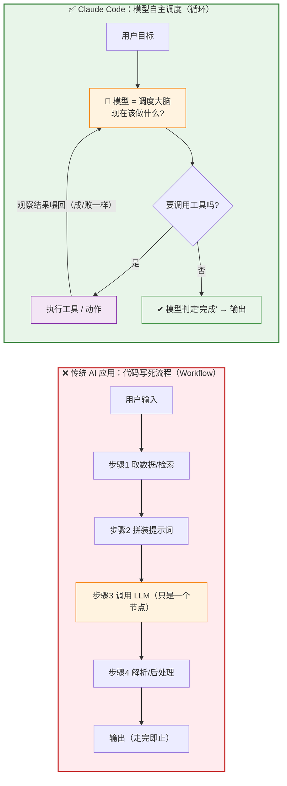

# 白板板书设计 · Agent 自主调度 vs 传统 AI 应用架构

> 主题：**Claude Code 的 Agent 调度模式** ↔ **传统 AI 应用架构（固定流程编排）**。
> 这是架构范式之争，不局限编码领域，本质是 "Workflow vs Agent"。
> 配置：**技术听众 · 5 分钟 · 16:9 横向白板**。板书总字数约 260 字，写满黑板刚好。
> 用法：每个 code block 是等宽字符画，可直接照抄到白板。

> ⏱ **节奏**：标题+核心问题 40s → 右边固定流程 1min → 左边自主循环 1.5min → 中间对比 1.5min → 金句 20s。

---

## 一、整体分区图（先在白板上划好这几块）

```
┌──────────────────────────────────────────────────────────────────────┐
│  ①  标题： Agent 自主调度  vs  传统 AI 应用架构                        │
│      核心问题：该由"代码"编排流程，还是让"模型"自主调度？               │
├───────────────────────────────┬──────────────────────────────────────┤
│   ②  左半区                    │   ③  右半区                          │
│   ✅ Claude Code：模型自主调度  │   ❌ 传统 AI 应用：代码写死流程       │
│      （画：一个闭合循环）        │      （画：一条固定流水线）           │
├───────────────────────────────┴──────────────────────────────────────┤
│  ④  中间对比条：6 个维度左右对着写                                      │
├──────────────────────────────────────────────────────────────────────┤
│  ⑤  底部金句区                                                         │
└──────────────────────────────────────────────────────────────────────┘
```

**关键视觉对比（讲解的灵魂）：**
- 左边画成一个**闭合的圈**：模型在圈里反复决策，路径是"跑"出来的 → 灵活、自适应
- 右边画成一条**从上到下的直管道**：步骤被代码钉死，LLM 只是其中一节 → 僵硬、走完即止

---

## 二、左半区：Claude Code —— 模型自主调度（照着画）

```
      ✅ Claude Code：Agent 自主调度（循环）
      ────────────────────────────────────

              ┌──────────┐
              │ 用户目标 │
              └────┬─────┘
                   ↓
     ┌──▶ ┌──────────────────┐
     │    │ 🧠 模型 = 调度大脑 │
     │    │   现在该做什么?     │
     │    └────────┬─────────┘
     │             ↓
     │      ◇ 要调用工具吗? ◇──否──▶ 模型判定"完成" → 输出 ✔
     │             │ 是
     │             ↓
     │    ┌──────────────────┐
     │    │  执行工具 / 动作   │
     │    └────────┬─────────┘
     │             ↓
     └──── 观察结果喂回（成功/报错 都一样）

   核心：控制权在模型 —— 走哪条路、走几步、何时停，全由它自己定
   框架只做 3 件事：转循环 · 递工具 · 管上下文
```

**讲这半区强调：** 模型是"指挥官"，不是"零件"。它每转一圈都重新判断下一步，遇到意外就把结果喂回去自我调整，能力随模型变强而水涨船高。

---

## 三、右半区：传统 AI 应用架构 —— 代码写死流程（照着画）

```
      ❌ 传统 AI 应用：开发者预先编排（Workflow）
      ──────────────────────────────────────

              ┌──────────┐
              │ 用户输入 │
              └────┬─────┘
                   ↓   ← 整条流程由代码预先写死
              ┌──────────────┐
              │ 步骤1 取数据/检索 │
              └────┬─────────┘
                   ↓
              ┌──────────────┐
              │ 步骤2 拼装提示词  │
              └────┬─────────┘
                   ↓
              ┌──────────────────────┐
              │ 步骤3 调用 LLM ← 只是一个节点 │
              └────┬─────────────────┘
                   ↓
              ┌──────────────┐
              │ 步骤4 解析/后处理 │
              └────┬─────────┘
                   ↓
                 输出（走完即止）

   核心：控制权在代码 —— LLM 只是流水线上被动"填空"的一环
   想加新能力 = 改代码、加节点、重新编排
```

**讲这半区点破痛点：** LLM 被降格成"零件"。流程是开发者提前拍脑袋定死的，遇到没预设的情况就走不下去；能力上限被编排逻辑锁死，模型再强也发挥不出来。

---

## 四、中间对比条（6 个维度，左右对撞，最出效果）

```
维度        ✅ Claude Code (Agent调度)      ❌ 传统AI应用 (固定编排)
──────────────────────────────────────────────────────────────
控制权    │ 模型自主决定下一步         ↔   开发者用代码写死流程
LLM角色   │ 调度大脑，主动指挥         ↔   流水线一个节点，被动填空
流程形态  │ 动态循环，步数不定         ↔   固定管道，步数钉死
遇到意外  │ 观察喂回，循环里自我调整    ↔   没预设就走不下去、断掉
扩展能力  │ 加个工具，模型自己组合      ↔   改代码、加节点、重编排
能力上限  │ 随模型变强而自动升高       ↔   被编排逻辑框死，模型再强也白搭
```

> 一行一行揭示，每行都是"模型说了算 vs 代码说了算"的一次对撞。
> 5 分钟版时间紧，可只留前 3 行（控制权 / LLM角色 / 流程形态），后 3 行口头带过。

---

## 五、底部金句区（收尾定格）

```
╔══════════════════════════════════════════════════════════════╗
║  💡 一句话总结：                                               ║
║                                                              ║
║  传统 AI 应用：把智能"编排"进代码 —— 代码指挥模型。            ║
║  Claude Code   ：把智能"释放"给模型 —— 模型指挥一切。          ║
║                                                              ║
║  框架越薄，模型越强，系统就越强。                              ║
╚══════════════════════════════════════════════════════════════╝
```

---

## 六、可投屏版（Mermaid，左右并排，用电脑演示时用）



---

## 七、讲解动线建议（先画什么后画什么）

1. **先写标题 + 核心问题**："该由代码编排流程，还是让模型自主调度？"——抛问题勾人。
2. **先画右边（传统）**：大家更熟悉（Chatbot、RAG、workflow 都是这套），从"LLM 只是零件"讲起，铺垫矛盾。
3. **再画左边（Claude Code）**：作为"范式跃迁"登场——LLM 从零件升级成指挥官。
4. **回到中间对比条**：一行行对撞，把"谁说了算"这个根本差异钉死。
5. **落到底部金句**：编排 vs 释放，升华收尾。

> 小技巧：左右两边的起点框（用户目标 / 用户输入）画在同一水平线上，视觉上更工整。

---

## 八、5 分钟 / 16:9 布局小抓手

- **左右各占约 45% 宽，中间留 10% 当红色分割线**，强化"两种范式对立"。
- 左边循环用**绿色**、右边流水线用**红色**，一眼分出"推荐 / 反面"。
- 右边刻意把"调用 LLM"那一节用别的颜色（橙）标出来，配一句"看，模型在这里只是一环"，反衬左边"模型是整个循环的大脑"。
- 核心记忆点就一句：**右边是"代码指挥模型"，左边是"模型指挥一切"。**
- 开场可在正中写大问号 **"谁说了算？"**，讲完擦掉换成底部金句，首尾呼应。
